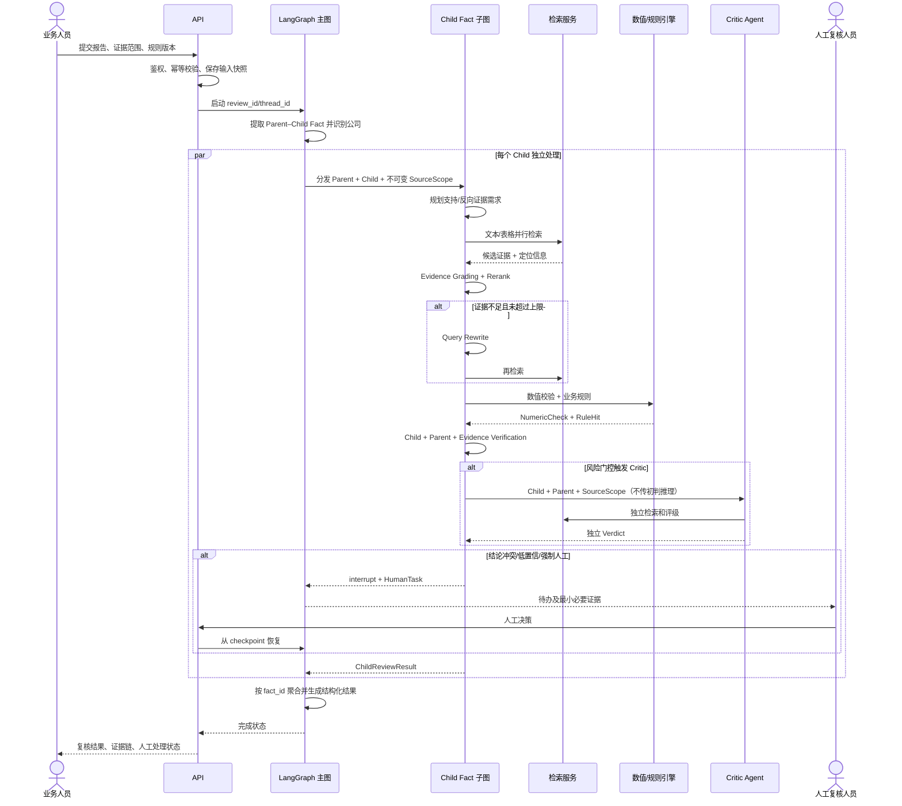

> 历史快照，已被 2026-09-16 Agentic RAG 重设计替代。不是当前开发要求。原有相对链接仅保留为历史文本。

# 金融信贷分析报告 AI 复核工作台：系统编码骨架

> 状态：编码输入，不是详细设计  
> 架构选型：[selected_architecture.md](selected_architecture.md)  
> 原则：显式主图、有界 Agent、确定性计算、风险触发 Critic、可中断人工复核

## 1. 建议目录结构

```text
Hallucination_detection/
├── src/credit_review/
│   ├── api/
│   │   ├── app.py                    # HTTP 应用入口、异常处理、中间件
│   │   ├── dependencies.py           # 身份、权限、运行时依赖装配
│   │   ├── schemas.py                # API 请求/响应模型
│   │   └── routes/
│   │       ├── reviews.py            # 创建、查询、取消复核任务
│   │       ├── human_tasks.py         # 人工复核提交与恢复
│   │       ├── annotations.py         # 业务证据标注回流
│   │       └── health.py              # 存活、依赖就绪检查
│   ├── graph/
│   │   ├── builder.py                # 组装并编译主图
│   │   ├── state.py                  # 主图/Child 子图 State 与 reducer
│   │   ├── routes.py                 # 条件边；不得调用外部服务
│   │   ├── nodes/
│   │   │   ├── intake.py             # 请求校验、报告载入、范围锁定
│   │   │   ├── decompose.py          # Parent–Child Fact 提取
│   │   │   ├── dispatch.py           # Child Fact 并行分发
│   │   │   ├── aggregate.py          # 汇总 Child 级结果
│   │   │   └── finalize.py           # 状态终结、输出与审计
│   │   └── subgraphs/
│   │       └── child_review/
│   │           ├── builder.py         # Child Fact 复核子图
│   │           ├── plan.py            # 证据需求规划
│   │           ├── retrieve.py        # 文本/表格检索 fan-out
│   │           ├── grade.py           # Evidence Grading + rerank
│   │           ├── rewrite.py         # 有界 Query Rewrite
│   │           ├── numeric_check.py   # 确定性数值校验
│   │           ├── rule_check.py      # 业务规则执行
│   │           ├── verify.py          # Child + Parent + Evidence 初步验证
│   │           ├── risk_gate.py       # Critic/人工/结束路由
│   │           ├── critic.py          # 独立取证和复核
│   │           ├── compare.py         # 初判与 Critic 冲突检测
│   │           └── human_review.py    # interrupt 与恢复结果接收
│   ├── domain/
│   │   ├── enums.py                  # 标签、状态、风险级别、证据关系
│   │   ├── models.py                 # Parent、Child、Evidence、Verdict 等领域模型
│   │   ├── errors.py                 # 稳定错误码与异常类型
│   │   └── invariants.py             # 领域不变量校验
│   ├── ports/
│   │   ├── llm.py                    # 模型网关接口
│   │   ├── retrieval.py              # Retriever/Reranker 接口
│   │   ├── documents.py              # 报告和原始材料接口
│   │   ├── rules.py                  # 规则仓库与规则引擎接口
│   │   ├── persistence.py            # Review/HumanTask/Checkpoint 接口
│   │   └── audit.py                  # 审计接口
│   ├── agents/
│   │   ├── parent_child_extractor.py # 结构化 Parent–Child Fact 抽取
│   │   ├── evidence_planner.py       # 结构化证据需求生成
│   │   ├── evidence_grader.py        # 四级证据关系判断
│   │   ├── fact_verifier.py          # Child + Parent + Evidence 初判
│   │   └── critic_verifier.py        # 独立复核；隔离初判推理
│   ├── retrieval/
│   │   ├── service.py                # 检索编排、去重、限额
│   │   ├── text_retriever.py         # 文本 Chroma 适配器
│   │   ├── table_retriever.py        # 表格 Chroma 适配器
│   │   ├── hybrid_retriever.py       # 并行合并
│   │   ├── reranker.py               # 可替换 rerank 适配器
│   │   └── filters.py                # 租户、主体、期间、文档 ACL 过滤
│   ├── verification/
│   │   ├── numeric.py                # 金额/比例/同比/单位确定性校验
│   │   ├── citation.py               # 来源、页码、表格坐标有效性
│   │   ├── sufficiency.py            # 证据组合充分性辅助逻辑
│   │   └── conflict.py               # 支持与反向证据冲突检测
│   ├── rules/
│   │   ├── engine.py                 # 规则执行与命中聚合
│   │   ├── registry.py               # 规则版本和启停
│   │   └── validators.py             # 规则定义合法性检查
│   ├── policies/
│   │   ├── risk.py                   # Critic/HITL 触发策略
│   │   ├── retry.py                  # 技术重试与语义重检索边界
│   │   └── confidence.py             # 置信等级映射；不使用模型自报概率
│   ├── infrastructure/
│   │   ├── llm_gateway.py            # 模型选择、脱敏、超时、限流、审计
│   │   ├── chroma.py                 # 现有向量库适配
│   │   ├── repositories.py           # 元数据/结果/人工任务持久化
│   │   ├── checkpoints.py            # LangGraph checkpointer
│   │   └── object_store.py           # 报告和证据快照存储
│   ├── security/
│   │   ├── auth.py                   # 身份认证适配
│   │   ├── authorization.py          # RBAC/ABAC 与资源范围校验
│   │   ├── redaction.py              # 发往模型前的敏感信息处理
│   │   └── audit.py                  # 不可抵赖审计事件
│   ├── observability/
│   │   ├── tracing.py                # run/parent/fact/node 三级 trace
│   │   ├── metrics.py                # 质量、时延、成本、人工升级指标
│   │   └── logging.py                # 结构化日志及敏感字段屏蔽
│   └── config/
│       ├── settings.py               # 环境配置和启动校验
│       └── model_profiles.py         # 各 Agent 的模型能力配置
├── configs/
│   ├── rules/                        # 版本化业务规则定义
│   ├── risk_policies/                # 风险门控配置
│   └── prompts/                      # 版本化 Prompt；禁止在节点散落
├── tests/
│   ├── unit/                         # 领域、规则、节点、条件边
│   ├── contract/                     # 模型、Retriever、存储接口契约
│   ├── graph/                        # 图路径、interrupt、resume、fan-out
│   ├── integration/                  # Chroma、checkpointer、API
│   ├── evaluation/                   # Child Fact 级离线评估
│   ├── e2e/                          # 脱敏端到端样本
│   └── fixtures/                     # 固定证据、规则、模型响应
├── datasets/
│   ├── schemas/                      # 标注和评估数据格式
│   └── README.md                     # 仅说明数据来源；敏感数据不入库
├── scripts/
│   ├── build_kb.py                   # 新构库入口；复用现有逻辑
│   ├── migrate_kb.py                 # collection/metadata 迁移
│   ├── run_evaluation.py             # 离线评估
│   └── validate_rules.py             # 规则发布前校验
├── docs/
├── pyproject.toml                    # 统一依赖、lint、test 配置
└── .env.example                      # 只放变量名，不放密钥
```

### 模块边界

- `domain` 不依赖 LangGraph、数据库和具体模型 SDK。
- `graph` 只负责编排；节点通过 `ports` 使用能力，不直接创建客户端。
- `agents` 必须返回结构化领域对象，不直接写数据库。
- `verification` 和 `rules` 优先保持纯函数，禁止调用 LLM。
- `infrastructure` 实现外部系统适配，不能承载业务判断。
- `api` 不直接调用 Agent；只能创建/查询任务或提交人工决策。

## 2. 核心领域数据结构

以下为接口草案；字段可扩展，但已发布字段不应随意改名。

```python
ReviewId = str
ParentId = str
FactId = str
EvidenceId = str
DocumentId = str

class EvidenceRelation(str, Enum):
    SUPPORTS = "supports"
    PARTIALLY_SUPPORTS = "partially_supports"
    IRRELEVANT = "irrelevant"
    CONTRADICTS = "contradicts"

class EvidenceStatus(str, Enum):
    SUFFICIENT = "sufficient"
    PARTIAL = "partial"
    INSUFFICIENT = "insufficient"

class IssueType(str, Enum):
    INSUFFICIENT_EVIDENCE = "insufficient_evidence"
    CITATION_MISMATCH = "citation_mismatch"
    OVERSTATEMENT = "overstatement"
    REASONING_GAP = "reasoning_gap"
    RISK_OMISSION = "risk_omission"

class VerdictStatus(str, Enum):
    SUPPORTED = "SUPPORTED"
    CONTRADICTED = "CONTRADICTED"
    INSUFFICIENT_EVIDENCE = "INSUFFICIENT_EVIDENCE"

class RiskLevel(str, Enum):
    LOW = "low"
    MEDIUM = "medium"
    HIGH = "high"
    CRITICAL = "critical"
```

### 2.1 输入和范围

```python
class ReviewRequest(BaseModel):
    report_id: str
    report_version: str
    tenant_id: str
    project_id: str
    subject_company_id: str | None
    source_scope: SourceScope
    requested_by: str
    idempotency_key: str

class SourceScope(BaseModel):
    allowed_document_ids: list[DocumentId]
    company_ids: list[str]
    periods: list[str]
    corpus_version: str
    rule_set_version: str
    data_classification: str

class CompanyInfo(BaseModel):
    company_id: str
    company_name: str
    stock_code: str | None
    resolution_method: Literal["deterministic", "llm_fallback", "human"]
    confidence_band: Literal["low", "medium", "high"]
```

`SourceScope` 在任务创建后视为不可变。Retriever 必须先执行范围和权限过滤，再做相似度检索。

### 2.2 Parent–Child Fact

```python
class ParentContext(BaseModel):
    parent_id: ParentId
    report_id: str
    parent_text: str
    source_span: TextSpan
    extraction_version: str

class ChildFact(BaseModel):
    fact_id: FactId
    parent_id: ParentId
    fact: str
    fact_type: str
    subject: str | None
    metric_names: list[str]
    periods: list[str]
    source_span: TextSpan
    importance: RiskLevel
    decomposition_version: str

class FactGroup(BaseModel):
    parent: ParentContext
    children: list[ChildFact]
```

不变量：Parent 优先使用原始完整句子，必要时使用原始段落；不得把 Parent 总结成新陈述。Child 必须可独立检索，但不得丢失主体、时间、数字、单位、比较、条件、联合关系、因果关系、否定或不确定性表达。

Parent 只用于恢复原始语境，绝不能作为外部 Evidence。每个 Child 必须通过 `parent_id` 追溯到唯一 Parent。

### 2.3 证据计划与检索查询

```python
class EvidenceNeed(BaseModel):
    need_id: str
    description: str
    evidence_type: Literal["text", "table", "hybrid"]
    polarity: Literal["support", "counter"]
    required_metrics: list[str]
    required_periods: list[str]
    sufficiency_hint: str | None

class RetrievalQuery(BaseModel):
    query_id: str
    fact_id: FactId
    need_id: str
    query_text: str
    retrieval_type: Literal["text", "table"]
    attempt: int
    filters: dict[str, str | list[str]]
```

### 2.4 证据

```python
class EvidenceLocator(BaseModel):
    document_id: DocumentId
    document_version: str
    file_name: str
    page: int | None
    section: str | None
    table_id: str | None
    row: str | None
    column: str | None
    content_hash: str

class EvidenceCandidate(BaseModel):
    evidence_id: EvidenceId
    locator: EvidenceLocator
    content: str
    retrieval_type: Literal["text", "table"]
    retrieval_score: float | None
    rerank_score: float | None
    query_id: str

class EvidenceAssessment(BaseModel):
    evidence_id: EvidenceId
    fact_id: FactId
    relation: EvidenceRelation
    rationale: str
    usable: bool
    cited_facts: list[str]
    grader_version: str
```

证据必须可回到原始文档版本；页码未知时不得伪造页码。

### 2.5 确定性校验和规则

```python
class NumericCheck(BaseModel):
    check_id: str
    expression: str
    operands: dict[str, Decimal]
    units: dict[str, str]
    periods: dict[str, str]
    expected: Decimal | None
    observed: Decimal | None
    tolerance: Decimal
    passed: bool | None
    failure_reason: str | None

class RuleHit(BaseModel):
    rule_id: str
    rule_version: str
    issue_type: IssueType
    severity: RiskLevel
    triggered: bool
    facts: dict[str, object]
    explanation: str
    required_human_review: bool
```

规则输入只能使用结构化 Child Fact、已评级证据和确定性计算结果；规则不得从自由文本中隐式取值。

### 2.6 验证结果

```python
class Verdict(BaseModel):
    status: VerdictStatus
    evidence_status: EvidenceStatus
    evidence_ids: list[EvidenceId]
    counter_evidence_ids: list[EvidenceId]
    issue_types: list[IssueType]
    reasoning_summary: str
    confidence_band: Literal["low", "medium", "high"]
    confidence_basis: list[str]
    verifier_version: str

class ChildReviewResult(BaseModel):
    fact_id: FactId
    fact: str
    parent_id: ParentId
    parent_text: str
    queries: list[RetrievalQuery]
    evidence: list[EvidenceCandidate]
    assessments: list[EvidenceAssessment]
    initial_verdict: Verdict
    critic_verdict: Verdict | None
    final_verdict: Verdict
    numeric_checks: list[NumericCheck]
    rule_hits: list[RuleHit]
    human_decision: HumanDecision | None
    trace_id: str

class ReviewResult(BaseModel):
    review_id: ReviewId
    workflow_status: str
    completed_results: list[ChildReviewResult]
    summary_counts: dict[str, int]
    corpus_version: str
    rule_set_version: str
    model_versions: dict[str, str]
    created_at: datetime
    completed_at: datetime | None
```

`confidence_band` 是策略校准后的等级，不允许直接等于模型自报概率。

### 2.7 支撑结构

```python
class TextSpan(BaseModel):
    start: int
    end: int
    section: str | None

class HumanDecision(BaseModel):
    task_id: str
    task_version: int
    decision: VerdictStatus
    issue_types: list[IssueType]
    selected_evidence_ids: list[EvidenceId]
    comment: str
    decided_by: str
    decided_at: datetime

class ErrorInfo(BaseModel):
    code: str
    category: str
    node: str
    retryable: bool
    safe_message: str
    attempt: int
    occurred_at: datetime

class RiskDecision(BaseModel):
    next_step: Literal["finalize", "critic", "human"]
    risk_level: RiskLevel
    reason_codes: list[str]

class DecomposeContext(BaseModel):
    report_id: str
    report_version: str
    input_language: str

class RuleContext(BaseModel):
    child: ChildFact
    parent: ParentContext
    evidence: list[EvidenceCandidate]
    assessments: list[EvidenceAssessment]
    numeric_checks: list[NumericCheck]
```

`HumanDecision`、规则命中和 Verdict 均为追加版本，不允许覆盖历史记录。

### 2.8 Parent–Child Extraction Prompt 契约

提取模块必须重新设计，不在旧 Atomic Fact Prompt 上简单加字段。输出固定为 Parent–Child 层级：

```json
{
  "fact_groups": [
    {
      "parent_id": "P001",
      "parent_text": "公司2024年营业收入同比增长20%，主要受海外市场拓展和新产品放量带动，但由于原材料成本上升，毛利率同比下降2个百分点。",
      "children": [
        {"fact_id": "F001", "fact": "公司2024年营业收入同比增长20%"},
        {"fact_id": "F002", "fact": "海外市场拓展和新产品放量共同构成公司营业收入增长的主要驱动因素"},
        {"fact_id": "F003", "fact": "原材料成本上升对公司毛利率产生负面影响"},
        {"fact_id": "F004", "fact": "公司毛利率同比下降2个百分点"}
      ]
    }
  ]
}
```

Prompt 必须要求：

- Parent 尽量保留原句，必要时保留原始段落；Parent 不是总结，也不是 Evidence。
- Child 不得创造原文没有的主体、数字、期间、条件或结论强度。
- 保留否定、比较、范围、因果、联合关系和“可能/预计/认为”等不确定性。
- 不得把“A 和 B 共同导致 C”拆成“A 单独导致 C”和“B 单独导致 C”。
- 每个 Child 必须有唯一 `parent_id`，且能够回到原报告 `source_span`。
- 输出只能是 schema 对象，不输出自由解释或 Chain-of-Thought。

### 2.9 Fact Verification Prompt 契约

Fact Verification 的输入必须分区传入：

```text
【待核验 Child Fact】
...

【原始语境 Parent】
...

【外部检索 Evidence】
Evidence 1: ...
Evidence 2: ...
```

Parent 仅用于语境理解，不能作为支持证据。输出只允许：

```json
{
  "status": "SUPPORTED",
  "reason": "简短可审计的判断依据",
  "evidence_ids": ["E01"],
  "confidence_band": "medium"
}
```

`status` 的允许值为 `SUPPORTED`、`CONTRADICTED`、`INSUFFICIENT_EVIDENCE`。
`confidence_band` 的允许值为 `low`、`medium`、`high`。

不保存或输出模型内部 Chain-of-Thought，只保留简短 reasoning summary。

## 3. LangGraph State 和参数传递

### 3.1 主图 State

```python
class ReviewGraphState(TypedDict, total=False):
    schema_version: str
    review_id: ReviewId
    original_input: str
    request: ReviewRequest
    source_scope: SourceScope
    report_snapshot_id: str
    fact_groups: list[FactGroup]
    company_info: CompanyInfo | None
    completed_results: Annotated[list[ChildReviewResult], append_by_fact_id]
    human_task_ids: Annotated[list[str], append_unique]
    workflow_status: str
    errors: Annotated[list[ErrorInfo], append]
    counters: dict[str, int]
    started_at: str
    completed_at: str | None
```

### 3.2 Child Fact 子图 State

```python
class ChildReviewState(TypedDict, total=False):
    review_id: ReviewId
    current_parent: ParentContext
    current_fact: ChildFact
    source_scope: SourceScope
    evidence_needs: list[EvidenceNeed]
    queries: list[RetrievalQuery]
    retrieval_attempt: int
    current_evidence: list[EvidenceCandidate]
    assessments: list[EvidenceAssessment]
    evidence_status: EvidenceStatus | None
    numeric_checks: list[NumericCheck]
    rule_hits: list[RuleHit]
    initial_verdict: Verdict | None
    critic_verdict: Verdict | None
    critic_required: bool
    human_required: bool
    human_task_id: str | None
    human_decision: HumanDecision | None
    verification_result: ChildReviewResult | None
    errors: list[ErrorInfo]
```

`ChildReviewState` 是单个 Child 的临时状态。每个 Child 完成后，将 `verification_result` 追加到主图 `completed_results`，再清理当前 Child 的查询、证据、评级和验证临时字段，不清空任务级状态。

### 3.3 运行时依赖

模型、数据库连接和 Retriever 不能放入 State。它们通过运行时上下文注入：

```python
@dataclass(frozen=True)
class RuntimeDependencies:
    principal: Principal
    settings: Settings
    clock: Clock
    document_store: DocumentStore
    review_repository: ReviewRepository
    checkpoint_store: CheckpointStore
    retrieval_service: RetrievalService
    llm_gateway: LLMGateway
    rule_engine: RuleEngine
    numeric_validator: NumericValidator
    risk_policy: RiskPolicy
    audit_sink: AuditSink
    tracer: Tracer
```

参数传递规则：

1. API 将 `ReviewRequest` 持久化并创建 `review_id`。
2. 主图 State 只保存可序列化、可审计、可恢复的数据。
3. `dispatch_children` 使用 Child 子状态并行分发，每个分支只处理一个 `fact_id`。
4. 并行结果按 `fact_id` 合并，禁止依赖完成顺序。
5. 节点通过 `RuntimeDependencies` 调用外部能力。
6. Critic 只接收 Child、Parent、`SourceScope` 和独立检索参数；不接收初判推理文本或初判结论。
7. 比较节点同时读取初判和 Critic 结果，并根据固定策略判断一致、冲突或人工升级。
8. 人工节点中断后，使用同一 `review_id/thread_id` 和 checkpoint 恢复。

### 3.4 节点接口约束

```python
def node_name(
    state: ReviewGraphState | ChildReviewState,
    runtime: Runtime[RuntimeDependencies],
) -> dict:
    """只返回 State 增量；禁止原地修改 State。"""
```

条件边必须是无副作用纯函数：

```python
def route_after_grading(state: ChildReviewState) -> Literal[
    "rewrite_query", "numeric_check", "mark_insufficient"
]: ...
```

## 4. 内部核心接口（Ports）

```python
class ParentChildExtractor(Protocol):
    def extract(self, original_input: str, context: DecomposeContext) -> list[FactGroup]: ...

class EvidencePlanner(Protocol):
    def plan(self, child: ChildFact, parent: ParentContext, rule_hints: list[str]) -> list[EvidenceNeed]: ...

class Retriever(Protocol):
    def retrieve(self, query: RetrievalQuery, scope: SourceScope) -> list[EvidenceCandidate]: ...

class Reranker(Protocol):
    def rank(self, child: ChildFact, candidates: list[EvidenceCandidate], limit: int) -> list[EvidenceCandidate]: ...

class EvidenceGrader(Protocol):
    def grade(self, child: ChildFact, parent: ParentContext, evidence: list[EvidenceCandidate]) -> list[EvidenceAssessment]: ...

class NumericValidator(Protocol):
    def validate(self, child: ChildFact, evidence: list[EvidenceCandidate]) -> list[NumericCheck]: ...

class RuleEngine(Protocol):
    def evaluate(self, context: RuleContext, rule_set_version: str) -> list[RuleHit]: ...

class FactVerifier(Protocol):
    def verify(self, context: VerificationContext) -> Verdict: ...

class CriticVerifier(Protocol):
    def verify_independently(self, context: CriticContext) -> Verdict: ...

class RiskPolicy(Protocol):
    def decide(self, context: RiskContext) -> RiskDecision: ...
```

所有接口必须支持：超时、取消、trace 信息、稳定错误码和测试替身。模型响应必须先完成 schema 校验才能进入 State。

上下文对象只做显式聚合，不允许接口依赖隐藏的全局变量：

```python
class VerificationContext(BaseModel):
    child: ChildFact
    parent: ParentContext
    assessments: list[EvidenceAssessment]
    evidence: list[EvidenceCandidate]
    numeric_checks: list[NumericCheck]
    rule_hits: list[RuleHit]

class CriticContext(BaseModel):
    child: ChildFact
    parent: ParentContext
    source_scope: SourceScope
    rule_set_version: str
    # 明确不包含 initial_verdict 和初判推理

class RiskContext(BaseModel):
    child: ChildFact
    parent: ParentContext
    initial_verdict: Verdict
    critic_verdict: Verdict | None
    rule_hits: list[RuleHit]
    has_counter_evidence: bool
```

## 5. 外部 API 骨架

| 方法 | 路径 | 作用 | 权限 |
|---|---|---|---|
| `POST` | `/v1/reviews` | 创建复核任务，返回 `review_id` | `review:create` |
| `GET` | `/v1/reviews/{review_id}` | 查询任务状态和汇总结果 | `review:read` + 资源范围 |
| `GET` | `/v1/reviews/{review_id}/facts` | 查询 Child Fact 级结果 | `review:read` |
| `GET` | `/v1/reviews/{review_id}/facts/{fact_id}` | 查询证据链和规则命中 | `review:read` |
| `GET` | `/v1/reviews/{review_id}/events` | SSE/轮询获取节点进度 | `review:read` |
| `POST` | `/v1/reviews/{review_id}/cancel` | 取消尚未终结的任务 | `review:cancel` |
| `GET` | `/v1/human-tasks` | 查询待人工复核任务 | `human:review` |
| `POST` | `/v1/human-tasks/{task_id}/decision` | 提交人工结论并恢复图 | `human:review` |
| `POST` | `/v1/annotations/evidence` | 回流证据级业务标注 | `annotation:write` |
| `GET` | `/health/live` | 进程存活 | 内部 |
| `GET` | `/health/ready` | 模型、存储、图依赖就绪 | 内部 |

API 约束：

- `POST /reviews` 必须接收幂等键；同租户相同键不得重复创建任务。
- 创建接口默认异步返回，不等待整份报告完成。
- API 只返回调用者有权访问的原文和证据片段。
- 人工提交包含 `task_version`，使用乐观锁避免重复覆盖。
- 已终结结果只允许追加更正版本，禁止静默覆盖。

## 6. 主链路时序

主图拓扑固定为：

```text
START → intake → extract_parent_child → resolve_company → dispatch_children
      → aggregate_results → finalize_review → END
```

Child Fact 子图拓扑固定为：

```text
START → plan_evidence → retrieve → grade_evidence
      ├─ INSUFFICIENT 且可重试 → rewrite_query → retrieve
      ├─ INSUFFICIENT 且重试耗尽 → mark_insufficient → risk_gate
      └─ SUFFICIENT/PARTIAL → numeric_check → rule_check → verify
                              → risk_gate
                                 ├─ finalize_child
                                 ├─ critic → compare → finalize_child/human_review
                                 └─ human_review
      → END
```

### 6.1 节点责任

| 节点 | 输入 | 输出 | 禁止事项 |
|---|---|---|---|
| `extract_parent_child` | `original_input` | `fact_groups` | 不得把 Parent 总结成新事实 |
| `resolve_company` | `original_input`、`fact_groups` | `company_info` | 不得只依赖 LLM；不确定时不得猜测 |
| `plan_evidence` | 当前 Child、Parent、公司 | `evidence_needs`、`queries` | 不得生成最终答案 |
| `text_retrieve` | 文本查询、`SourceScope` | 文本 Evidence | 不得越权访问语料 |
| `table_retrieve` | 表格查询、`SourceScope` | 表格 Evidence | 不得丢失表格定位信息 |
| `grade_evidence` | Child、Parent、候选 Evidence | `assessments`、`evidence_status` | 不得直接给最终 Verdict |
| `rewrite_query` | Child、Parent、历史 Query/Evidence | 新 Query | 仅在 `INSUFFICIENT` 时触发，最多一次 |
| `mark_insufficient` | 当前 Child、全部检索结果 | `INSUFFICIENT_EVIDENCE` 候选结果 | 不得改判为 `CONTRADICTED` |
| `numeric_check` | Child、可用 Evidence | `numeric_checks` | 不得让 LLM 代替计算 |
| `rule_check` | 结构化事实、Evidence、数值结果 | `rule_hits` | 规则失败时不得静默跳过 |
| `verify` | Child、Parent、Evidence、评级、规则结果 | 初步 `Verdict` | 不得把 Parent 当 Evidence |
| `risk_gate` | 初判、规则命中、冲突和风险策略 | `finalize`/`critic`/`human` | 不得绕过强制人工条件 |
| `critic` | Child、Parent、独立范围 | 独立 `Verdict` | 不得读取初判推理和结论 |
| `compare` | 初判、Critic | 一致/冲突/人工路由 | 不得用平均分掩盖冲突 |
| `finalize_child` | 全部 Child 状态 | `ChildReviewResult` | 不得丢失 Parent、Evidence 或定位 |
| `aggregate_results` | 全部 Child 结果 | `ReviewResult` | 不得重新编造未验证结论 |

### 6.2 临时状态清理

以一个 Child 为最小执行单元：

```text
current_parent + current_fact
        ↓
current_queries + current_evidence + verification_result
        ↓
completed_results.append(result)
        ↓
清理 current_* 临时字段，进入下一个 Child
```

任务级的 `original_input`、`fact_groups`、`company_info`、`completed_results`、版本信息和审计引用不得清理。



### 关键路由表

| 条件 | 路由 |
|---|---|
| 报告无法解析、主体不明或范围有歧义 | 人工澄清或任务失败，不猜测 |
| 证据评级不足且 `attempt < max_attempts` | Query Rewrite → 再检索 |
| 达到重检索上限仍无充分证据 | `INSUFFICIENT_EVIDENCE`；高风险时人工 |
| 数值、单位或期间不一致 | 命中规则 → 风险门控 |
| 存在反向证据 | Critic；高严重度可直接人工 |
| 强结论、高风险规则或低置信 | Critic |
| 初判与 Critic 冲突 | 人工复核 |
| 高风险强制人工策略命中 | 无条件人工，即使模型一致 |
| 无触发且证据充分 | 形成 Child 结果 |

## 7. 权限、隔离与责任边界

### 7.1 角色

| 角色 | 允许操作 |
|---|---|
| 业务查看者 | 创建任务、查看授权范围内结果 |
| 人工复核员 | 查看待办、提交复核结论和理由 |
| 标注员 | 提交证据标签，不修改正式结论 |
| 规则管理员 | 草拟规则；发布需双人复核（**待业务确认**） |
| 审计员 | 只读访问审计记录和版本历史 |
| 系统管理员 | 运维配置；默认不能查看业务原文 |
| 服务账号 | 按最小权限访问模型、存储和队列 |

### 7.2 数据隔离

- 最低隔离键：`tenant_id + project_id + source_scope`。
- 检索前完成权限过滤，禁止“先全库召回、再过滤结果”。
- 银行材料、学院测试数据和公开数据使用独立 namespace/collection；生产是否需要物理隔离 **待定**。
- Checkpoint、结果、证据快照、标注和审计记录均携带隔离键。
- 缓存键必须包含租户、语料版本、Prompt 版本和模型版本，禁止跨租户命中。

### 7.3 模型边界

- 所有模型访问只能经过 `LLMGateway`；节点不得直接使用供应商 SDK。
- Gateway 执行模型白名单、数据分级检查、脱敏、超时、限流和调用审计。
- 未获批准时，银行敏感数据不得发送给外部模型服务。
- Prompt 和模型输出均视为不可信输入，必须做 schema、长度和内容校验。
- 检索内容可能包含 Prompt Injection；证据文本只能作为数据，不能获得工具权限。
- API Key 使用环境密钥或密钥管理服务；严禁写入源码、State、日志或测试夹具。

### 7.4 Agent 隔离

- Agent 只能使用显式注入的工具和当前 `SourceScope`。
- Child 分支之间默认不共享推理上下文，只共享最终结构化结果。
- Critic 不读取初判的 chain-of-thought、理由全文或置信结论；比较节点负责对齐结果。
- Aggregator 不能改变 Child Verdict，只能汇总和展示。
- 任一 Agent 都不能直接批准信贷、修改原始报告或扩大数据访问范围。

### 7.5 人工责任边界

- 人工可以确认、驳回、修改最终标签，必须填写理由并关联证据。
- 人工决策保留原模型结果，不覆盖历史记录。
- 人工修改 SourceScope 或追加证据时生成新版本并重新运行受影响 Child。
- 最终信贷判断始终由有权限的银行业务人员承担。

## 8. 配置骨架与默认限制

```yaml
workflow:
  max_retrieval_attempts: 2       # 初始建议；需用测试集校准
  max_children_per_review: null   # 待业务容量确认
  child_parallelism: null         # 待模型限流和存储压测
  node_timeout_seconds: null      # 各外部节点分别配置

retrieval:
  initial_top_k: 12               # 初始建议
  rerank_top_n: 6                 # 初始建议
  require_counter_search_for_high_risk: true
  embedding_model: null
  corpus_version: required

risk_policy:
  critic_on_low_confidence: true
  critic_on_counter_evidence: true
  critic_on_high_risk_rule: true
  human_on_critic_conflict: true
  mandatory_human_levels: [critical]

models:
  decomposer: null
  planner: null
  grader: null
  verifier: null
  critic: null

security:
  external_llm_allowed_classifications: []  # 默认拒绝
  evidence_excerpt_max_length: null
```

所有阈值必须进入版本化配置和运行快照，不能散落在 Prompt 或节点源码中。

## 9. 错误、重试、幂等与恢复

### 错误分类

- `INPUT_ERROR`：报告、范围或 schema 不合法；不自动重试。
- `AUTHZ_ERROR`：越权或范围不匹配；立即停止并审计。
- `TRANSIENT_ERROR`：超时、限流、临时网络失败；技术重试。
- `MODEL_OUTPUT_ERROR`：模型输出无法解析；有限格式修复/重试后失败。
- `RETRIEVAL_EMPTY`：合法业务结果；进入重写或证据不足，不作为系统异常。
- `RULE_ERROR`：规则定义或执行失败；不得绕过规则继续给出通过结论。
- `CHECKPOINT_ERROR`：状态无法持久化；停止推进，避免不可恢复执行。

### 重试边界

- 技术重试只处理可恢复外部错误，采用退避并保留同一调用幂等键。
- Query Rewrite 属于业务流程，不与技术重试混用。
- Critic 不是普通重试，必须产生独立 trace 和证据集合。
- 达到上限后输出明确状态，禁止无限 Agent 循环。

### 恢复

- 每个主图 super-step 持久化 checkpoint。
- 外部写操作使用 `review_id + node_name + attempt` 作为幂等键。
- 人工中断保留待执行节点、State 版本和任务版本。
- 取消任务不删除证据、审计和已完成 Child；只阻止后续节点。

## 10. 可观测性和审计

### 10.1 持久化边界

| 数据集合 | 保存内容 | 更新方式 |
|---|---|---|
| `review_runs` | 请求范围、状态、版本、时间和汇总 | 状态机受控更新 |
| `facts` | Parent/Child 及原报告位置 | 创建后不可变；修订生成新版本 |
| `evidence_snapshots` | 证据片段、定位、hash、语料版本 | 追加，不覆盖 |
| `fact_results` | 初判、Critic、最终结果及使用版本 | 追加版本 |
| `human_tasks` | 中断状态、分配、决策和乐观锁版本 | 状态转换 |
| `annotations` | 业务人员证据标签和坏案例归因 | 追加，可撤销标记 |
| `rule_sets` | 规则定义、审批状态和发布时间 | 版本化发布 |
| `audit_events` | 权限、调用、状态变化和人工操作 | 只追加 |

具体数据库选型 **待定**；领域接口不得依赖数据库表结构。原始报告与大体量证据放对象存储，State 和结果只保留引用及必要快照。

### 10.2 观测字段

每次运行至少记录：

- `review_id`、`parent_id`、`fact_id`、`node_name`、`trace_id`。
- 输入/输出 schema 版本、模型版本、Prompt 版本、规则版本、语料版本。
- 检索 query、过滤条件、候选 evidence_id、分数和最终引用。
- 节点耗时、模型 token/成本、重试次数和错误码。
- 风险门控原因、Critic 触发原因和人工升级原因。
- 人工操作人、时间、前后值、理由和任务版本。

日志默认不记录完整报告、完整证据、密钥或模型原始 chain-of-thought。

## 11. 测试与评估骨架

### 11.1 单元测试

- Child 的数字、主体、期间不被拆分器新增或改变。
- EvidenceRelation、Verdict、IssueType 的不变量。
- 数值公式、单位换算、同比和容差边界。
- 20 多条规则的正例、反例、边界和冲突优先级。
- 每条条件边的路由表覆盖。
- Critic/HITL 触发策略。

### 11.2 契约和集成测试

- LLM 输出 schema、超时、限流和无效 JSON。
- Retriever 权限过滤、collection 命名、空结果和重复证据。
- Checkpoint 中断、恢复、重复提交和版本冲突。
- 并行 Child 乱序完成后的确定性合并。
- API 幂等、权限和敏感字段屏蔽。

### 11.3 Child Fact 级离线评估

业务标注最小单位为 Child—Parent—Evidence，不以整份报告为唯一评价对象。

核心指标：

- Parent–Child decomposition 完整率和边界准确率。
- 检索 Recall@K、反向证据 Recall@K、rerank NDCG/MRR。
- Evidence Grading 四分类 Macro-F1。
- 五类问题标签分别计算 Precision、Recall、F1。
- 数值校验 Exact Match。
- 高风险错误漏检率和严重错误逃逸率。
- Critic 冲突识别率、人工升级召回率和过度升级率。
- 单 Child P50/P95 时延、模型调用次数和成本。

“约 90% 核心复核准确率”在明确样本、指标、标签分布和独立测试集前只作为背景数据，不作为验收门槛。

### 11.4 必备坏案例集

- 收入增长被推导为现金流改善。
- 单一流动比率被推导为偿债能力较强。
- 正确证据但期间、单位或主体错配。
- 只存在相关证据，没有充分证据。
- 支持证据与反向证据并存。
- 结论有依据但措辞强度过高。
- 未召回证据、OCR 错误、跨公司误召回。
- 高置信但规则要求强制人工。

### 11.5 Parent–Child 基础测试样例

#### 联合因果不得过度拆分

输入：

```text
公司2024年营业收入同比增长20%，主要受海外市场拓展和新产品放量带动，但由于原材料成本上升，毛利率同比下降2个百分点。
```

期望 Parent：原始完整句子，`parent_id = P001`。

期望 Children：

```text
F001：公司2024年营业收入同比增长20%
F002：海外市场拓展和新产品放量共同构成公司营业收入增长的主要驱动因素
F003：原材料成本上升对公司毛利率产生负面影响
F004：公司毛利率同比下降2个百分点
```

F002 不得继续拆成“海外市场拓展单独推动收入增长”和“新产品放量单独推动收入增长”。

#### 多因素影响不得复制同一影响量

输入：

```text
由于原材料价格上涨和运输成本增加，公司毛利率同比下降3个百分点。
```

可以保留为一个联合 Child，或拆为“毛利率同比下降3个百分点”和“两个因素共同对下降产生影响”；不得生成两个分别造成完整 3 个百分点影响的事实。

#### 不确定性不得被强化

输入：

```text
管理层预计，随着海外需求回暖，公司2025年收入可能实现进一步增长。
```

Child 必须保留“管理层预计”“可能”和“海外需求回暖”条件，不得改写成“公司2025年收入将进一步增长”。

#### Parent–Child–Evidence 数据流

```text
原始输入
↓
Parent P001
├── Child F001
├── Child F002
├── Child F003
└── Child F004

Child F002
↓
Query Planning
↓
Text Retrieval + Table Retrieval
↓
Evidence Evaluation
↓
INSUFFICIENT？→ Query Rewrite（最多一次）→ 再次检索
↓
Fact Verification
输入：Child F002 + Parent P001 + 外部 Evidence（含页码）
↓
SUPPORTED / CONTRADICTED / INSUFFICIENT_EVIDENCE
```

## 12. 当前代码迁移映射

| 当前文件 | 目标位置/处理 |
|---|---|
| 旧 `Build_kb/`、`tool/`、`atomic_fact/`、`OpenFActScore/` 及根目录脚本 | 已删除；不保留旧接口兼容层 |
| 新确定性能力 | 位于 `src/credit_review/`，由 Graph、agents、retrieval、verification、rules 和 policies 组合 |

旧流程如需对照，只作为只读离线基线；不为其新增兼容层，不让新旧流程同时写同一结果表。

## 13. 编码前必须确认的事项

1. 银行侧数据分类、部署位置、外部模型白名单和网络出站政策。
2. 正式的报告输入格式、OCR schema、文档版本和页码定义。
3. 公司/租户/项目的隔离级别及 Chroma 是否满足生产要求。
4. 20 多条业务规则的机器可执行定义、负责人和审批发布流程。
5. 高风险 Child 清单及强制人工条件。
6. 人工任务系统是内建、对接银行工作台还是仅提供 API。
7. 主模型和 Critic 是否使用不同模型/Prompt/检索策略。
8. 置信等级的校准数据和门槛。
9. 约 90% 指标的准确口径和可复现测试集。
10. 数据保留、删除、审计留存和模型调用记录要求。

以上未确认项不得由开发人员自行隐含假设；对应配置应默认采取更保守的拒绝或人工升级策略。

## 14. 建议编码顺序

1. 先冻结 `domain` 模型、枚举、不变量和 API schema。
2. 用假 Retriever、假 LLM 和内存 checkpointer 跑通主图及 Child 子图全部路由。
3. 接入现有 Chroma，只验证检索契约和权限过滤，不同时改造构库。
4. 接入数值校验、规则引擎和 Child 级离线测试集。
5. 接入持久化、人工 interrupt/resume、审计和 API。
6. 最后启用风险触发式 Critic，并通过特性开关保留关闭能力。

编码期间每一步都应保持可运行的端到端薄链路；禁止在主图尚未可测试时同时引入 Supervisor、Swarm 或新的向量数据库。
