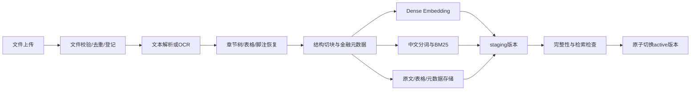

# 一键建库：产品流程与技术设计

> 日期：2026-09-16；状态：文件版一键建库闭环已实现，产品化上线能力继续推进。
> 当前 `scripts/build_kb.py` 已支持 MinerU JSON → Parent–Child/Evidence/metric_ids 快照；`BuildManager` 已实现幂等创建、阶段状态、失败可查询、staging、原子 active 发布和版本固定检索，`ReviewAPI` 已提供最小建库/版本/检索路径。上传、持久双索引、队列后台任务、SSE 和页面仍是产品化工作。

## 1. 用户流程

1. 进入“知识库”，创建或选择知识库；首次设置名称和使用范围。
2. 上传财报、公告或业务材料，可批量添加。系统识别格式、重复文件及候选公司/期间，用户可修改识别结果。
3. 点击 **一键建库**。默认使用“金融文档”配置，不要求用户填写向量维度、分词器或集合名称。
4. 页面持续显示“排队 → 解析 → 整理内容 → 建立索引 → 检查 → 可用”，并显示已完成文件数、失败文件和可重试原因。
5. 校验通过自动发布。完成后显示文档数、表格数、证据片段数和新版本，并提供“检索试用”“查看原文”“开始报告复核”。

正常路径一次启动即可完成。只有无法自动处理的实体歧义、加密文件或解析失败需要用户处理；不对每个阶段额外要求批准。已有版本在新任务执行期间继续提供检索。

内容维护支持追加资料、替换更正稿、删除文档和重建索引。删除是单独的显式用户操作，更新文件不会隐式删除其他文档。

## 2. 建库流水线



### 输入与解析

- 首批交付 TXT/Markdown、文本 PDF、已有 OCR JSON；一键建库上线前补齐扫描 PDF/OCR。DOCX/XLSX 通过后续 parser adapter 扩展，页面只允许已支持格式。
- 文本 PDF 先原生解析，按页判断无文本/乱码并转 OCR；不能整本无差别 OCR。
- 保留原文件和解析产物，记录 parser 名称、版本、参数、页码、坐标与解析质量。
- 表格保存结构化单元格、原始数值字符串、行/列表头、单位、币种、表名及脚注关联；跨页表格合并必须保留各页定位。
- 无法恢复的列对齐或低质量数字进入质量问题列表。不得用 LLM 猜测缺失单元格。

解析与切块的工程参考是 [RAGFlow](https://github.com/infiniflow/ragflow) 的文档理解和建库组织方式；本项目通过 Parser 接口接入已有 OCR/MinerU 等产物，不在本轮绑定整套第三方应用。

### 切块与检索文本

- 来源层级：`Document → Section → Chunk`；另存 `Table → Row/Cell`。
- 文本优先按标题、段落切块，超长段再按句切；初始目标 400–800 tokens，必要时约 80 tokens 重叠，按语料评估调整。
- 表格按行组切块，每块附带完整相关表头、单位、期间和脚注索引；整表保存在 DocStore。
- `source_text` 是可引用原文；`retrieval_text` 可在前方加经校验的公司、标题、期间和表头；两者不能混用。
- 导航摘要、合成检索问句可以额外索引，但必须标记 `derived=true` 并回链原文，不能作为最终数值或结论证据。
- 公司、证券代码、指标别名、期间、披露日期、合并范围、币种、重述标记抽取后分别保存值和来源，缺失字段显式为空。

### 统一标识与存储

```text
Document: doc_id, tenant_id, kb_id, source_uri, source_hash, document_version,
          published_at, report_period, company_ids, access_policy, parser_version
Chunk: chunk_id, doc_id, document_version, section_id, source_text,
       retrieval_text, locator, source_hash, metadata, extraction_warnings
TableCell: table_id, row_key, column_key, value_raw, value_decimal,
           metric_id, period, unit, currency, statement_scope, locator
KBManifest: kb_version, documents, chunk_manifest_hash,
            dense_index_ref, bm25_index_ref, docstore_ref,
            embedding_profile, tokenizer_profile, parser_profile, status
```

当前 provider-free 构建器会在 Parent/Child/Evidence 快照上附加 `metric_ids` 和
`structured` 标记。它们来自已注册的金融指标别名，只用于路由和召回；数值仍必须回到
原始表格单元格、表头和脚注核验。生产版再将这些字段写入 TableCell/结构化数据库；文本索引可由
`create_production_hybrid_search` 写入同一 KB 版本目录下的 Dense JSON 与 BM25S 目录。模型名称和可选
revision 会写入索引/运行配置；生产环境应设置 `CREDIT_REVIEW_EMBEDDING_REVISION` 与
`CREDIT_REVIEW_RERANKER_REVISION`，避免模型更新后复用旧向量。

`doc_id` 来自登记系统，不能只用文件名 stem；同名文件必须可区分。`chunk_id` 可由文档版本、来源定位、切块器版本和内容 hash 构造，重试可复用。重复内容不同出处可聚合展示，但不能抹掉来源记录。

DocStore 是原文和定位的权威存储；Dense、BM25、章节导航都是可重建派生索引。Embedding/分词器/切块规则改变时产生新 KB 版本，禁止新查询向量搜索旧模型生成的向量。

## 3. 一致性、增量与发布

1. 创建 staging manifest，冻结本次文件清单和构建配置。
2. 使用 `tenant + kb + request_id` 防止重复点击创建多个任务；同请求 ID 不同请求体返回冲突。
3. 未变更文件复用经过校验的解析/Embedding 缓存；缓存按内容与配置版本键控。新增、更正和删除生成新的完整逻辑快照。
4. BM25S 每次按新版本完整语料重建词频统计，即使只对新 chunk 做 Embedding；IDF 随语料变化，不能只追加得分数组。
5. 向量、BM25、DocStore 使用同一 chunk manifest，逐项检查 ID/版本/hash；不能以数量相同代替内容一致性。
6. 两路索引和原文均通过校验后，在元数据事务中比较并交换 `active_kb_version`。同库并发发布检测基版本冲突并要求重新合并，不能后完成的旧任务覆盖新资料。
7. 在线请求开始时固定 `kb_version`，该次所有补查保持同一版本；发布后新请求看到新版本，已有请求继续读其快照。
8. 撤销访问权限必须立即影响查询及原文回取，不能等待重建。删除产生 tombstone 并执行访问检查，再异步清理各旧索引和缓存；历史版本不允许绕过撤权。

默认整批全成功才自动发布；任何必需阶段失败都保留旧 active 版本。用户可以明确选择排除失败文档后重建并发布，但不能把部分成功展示为全部成功。

## 4. 任务状态与恢复

```text
QUEUED → VALIDATING → PARSING → ENRICHING → INDEXING → CHECKING
       → PUBLISHING → READY
任一发布前阶段 → FAILED / CANCELLED / NEEDS_INPUT
```

- 每个文档记录子状态、进度、错误码、重试次数和解析产物；任务汇总采用真实计数，不显示虚构进度。
- 失败重试从最近已校验步骤恢复，相同输入不重复计费或重复写入；外部调用超时但结果不明时先检查产物/幂等键。
- 取消设置持久化标记，worker 在安全边界停止并清理 staging；发布前再次检查取消标记。若事务已发布则返回 READY，不能把已发布任务说成取消成功。
- worker 使用租约与心跳；进程异常后任务可被重新领取。队列、任务仓库及 manifest 均需持久化。
- 技术失败保留结构化错误：`UNSUPPORTED_FORMAT`、`PDF_ENCRYPTED`、`OCR_FAILED`、`TABLE_PARSE_LOW_QUALITY`、`EMBEDDING_FAILED`、`INDEX_MISMATCH`、`PUBLISH_CONFLICT`。

## 5. API 与界面契约（部分已实现）

| 接口 | 用途 |
|---|---|
| `POST /knowledge-bases` | 创建知识库，返回 kb_id |
| `POST /knowledge-bases/{kb_id}/documents` | 上传并登记文件，返回 document_ids 与检查结果 |
| `POST /knowledge-bases/{kb_id}/builds` | 一键启动，输入 document_ids/profile_id/idempotency_key；返回 202 + build_id |
| `GET /knowledge-bases/{kb_id}/builds/{build_id}` | 阶段、文件计数、错误和发布版本 |
| `GET /knowledge-bases/{kb_id}/builds/{build_id}/events` | SSE 推送；断线可回退轮询 |
| `POST /knowledge-bases/{kb_id}/builds/{build_id}/retry` | 重试失败步骤 |
| `POST /knowledge-bases/{kb_id}/builds/{build_id}/cancel` | 请求取消 |
| `GET /knowledge-bases/{kb_id}/versions` | 查询历史发布版本 |
| `POST /knowledge-bases/{kb_id}/search` | 检索试用；可返回 Dense/BM25/Rerank 分项调试信息 |
| `DELETE /knowledge-bases/{kb_id}/documents/{doc_id}` | 显式删除与即时撤回可读资格 |

当前 FastAPI 适配器已提供对应的最小路径：
`POST /v1/knowledge-bases/builds`、`GET /v1/knowledge-bases/builds/{build_id}`、
`POST /v1/knowledge-bases/builds/{build_id}/cancel`、
`GET /v1/knowledge-bases/{kb_id}/versions` 和
`POST /v1/knowledge-bases/{kb_id}/search`。它们需要注入 `BuildManager`；上传、队列异步执行、SSE 进度和权限中间件仍待产品化。

最小建库请求必须带 `kb_id`、`tenant_id`、`requested_by`、`idempotency_key` 和 `source`；可选
`kb_version`、`document_id`、`source_name`、`expected_active_version`。重复的
`tenant_id + kb_id + idempotency_key` 返回同一个构建记录。检索请求可传 `kb_version` 固定历史版本，
否则读取 active 版本；同一个 `KnowledgeBaseSearchService` 实例的多轮补查会继续使用首次解析的版本。

请求中的 tenant/user 身份从服务端认证上下文获得。检索试用与报告复核共用检索服务，不各写一套召回逻辑。

用户界面展示文件、章节、表格及可点击引用；管理员诊断页再展示解析版本、召回分数和索引状态。

## 6. 上线验收

- 同一批文件重复点击只产生一个逻辑任务；worker 重启后可继续。
- 文本 PDF、扫描 PDF、表格、同名文件、更正稿分别验证。
- Dense、BM25、原文映射一致；索引失败时 active 版本不改变。
- 发布并发、取消与发布竞态、删除后缓存命中均有集成测试。
- 引用可打开原文的正确位置；未知页码不伪造，表格低质量问题可见。
- 上传完成不等于建库成功，READY 必须表示已校验且已发布可检索版本。
- 文档中预置的“更改系统指令”等内容只作为待检索数据，不可控制 Agent、解析配置或工具权限。
