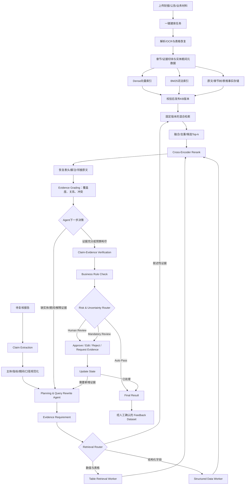

# 金融 Agentic RAG：架构方案

> 日期：2026-09-16；状态：新设计基线；核心检索、MinerU 快照建库和文件版一键建库已实现，生产索引与异步产品化继续推进。
> 配套：[系统骨架](system_skeleton.md) · [一键建库](knowledge_base.md) · [论文与项目调研](rag_research.md) · [当前实现与迁移](handoff.md)

## 1. 目标与架构选择

建设面向金融信贷报告复核的 Agentic RAG：从原始财报、公告和业务材料建立可更新的知识库，由 Agent 围绕每条待核验结论主动规划检索、调用工具、判断证据缺口并补查，最后生成带原文引用的核验结果。同一个检索内核可供后续金融问答复用；首版业务入口仍是报告复核。

采用 **实体与时间感知的分层混合检索 + Cross-Encoder Rerank + 证据驱动的有界 Agent 循环**。这是结合近期研究与工程约束形成的本项目设计，不是某篇论文的完整复现，也不宣称在本地金融数据上已经达到最优。

核心采用决策规划、工具选择和反馈式补查，参考 [2026 年 Agentic RAG 综述](https://aclanthology.org/2026.findings-acl.78/)。金融章节定位参考 [FinGEAR](https://arxiv.org/abs/2509.12042)；具体适配、证据契约和预算由本项目定义。

必须交付两条完整链路：

1. **离线建库**：接入 → 解析/OCR → 结构化切块 → 金融元数据 → Embedding + BM25 → 质量检查 → 发布版本。
2. **在线检索与核验**：实体/任务提取 → Agent 规划 → Dense + BM25 → 候选融合 Top-k → Rerank → 原文上下文恢复 → 证据评估 → 补查或生成 → 引用/数值核验。

Parent–Child Fact 是报告适配层。知识库中的 Document–Section–Chunk 是来源材料层。两者必须分开命名和存储，避免待复核报告成为自证证据。

## 2. 总体逻辑



这张图采用报告复核的顶层视角。`Text / Table / Structured Data` 是三类受权限、KB 版本和预算约束的检索 Worker/工具，不是拥有自由决策权的三个 Agent：文本 Worker 内部执行 Dense + BM25 → RRF → Rerank；表格 Worker 返回带表头、脚注和定位的单元格；结构化数据 Worker 查询已授权的指标或企业主数据。这样既能并行召回，也不会让每个数据源自行扩大检索范围。

图中的循环由决策枚举和预算控制。Evidence Grading 只判断证据覆盖、支持关系和冲突；它发现缺口后回到 Planning Agent。Claim-Evidence Verification 才给出三态事实结论，Business Rule Check 叠加业务约束，Risk & Uncertainty Router 决定自动通过、普通人工复核或强制人工复核。人工要求补证据时恢复同一个 Claim State，而不是重跑整份报告。反馈数据集只收录已经确认的人工动作、最终证据和版本化标签，用于离线评估、规则改进或后续训练；不能自动改变线上索引、提示词或结论。

## 3. 在线流程逐步设计

### 3.1 输入理解：实体、时间、指标和任务

报告入口先提取 Parent 语境与可核验 Claim，再形成 `QueryContext`：

- 实体：公司全称、简称、证券代码、统一主体 ID、母子公司关系候选。
- 时间：目标财务期间、比较期间、信息截止日 `as_of`。
- 指标：营业收入、归母净利润、经营活动现金流净额等标准名与原始说法。
- 口径：币种、单位、合并/母公司报表、实际/预测、重述/原报值。
- 意图：数值查询、跨期比较、原因解释、风险事实、跨文档关系。
- 证据需求：需要哪些期间的数值、哪些解释段落、哪些反向证据。

规则和企业别名表先做实体规范化，LLM 补充候选和缺失字段；候选必须保留原文跨度与识别来源。实体歧义进入 `NEEDS_INPUT`，不能随意挑一家。元数据缺失与确认不符分开处理。

`SourceScope` 由服务端确定，约束租户、KB、可读文档和信息截止时间。Agent 只能在授权范围内改变业务查询；不能扩大权限。财务期间不等于披露日期：2024 年年报可能在 2025 年发布，历史查询必须按 `published_at <= as_of` 控制可用信息。披露日期不明的材料不能用于证明截止日之前已经可知的事实，须单独标记时间资格未核实。

### 3.2 Planning Agent：概念展开、Query Rewrite 与检索参数

本项目使用一个 Planning Agent 负责从 Claim 到检索请求的完整转换，不再为“偿债能力”等概念单独创建另一个 Agent。它读取 Claim、Parent 语境、主体类型、期间、指标注册表、历史检索结果和当前证据缺口，在首次规划或后续 Query Rewrite 时直接生成 `RetrievalPlan`。

例如 Claim 包含“偿债能力较强”，对一般工商企业，Agent 可以展开为流动比率、速动比率、资产负债率、利息保障倍数和经营现金流覆盖等候选证据需求；对银行则应选择适用的监管流动性和资本指标。相同机制也用于“盈利能力较强”“成长性良好”“现金流质量较高”“经营稳定”“治理合规”等定性判断。Agent 负责语义判断和需求展开；指标注册表只提供可选指标、公式版本与行业适用性，执行器拒绝未知指标或越权参数，不能临时发明公式。

生产路径采用 **LLM-first、规则兜底**：配置 DeepSeek 等模型时，由 LLM 直接生成完整 `RetrievalPlan`；模型故障、超时或输出不合规时，才回退到本地确定性模板。模板用于离线测试和无模型环境，不能替代线上 LLM 的概念判断。

Agent 的输出必须是结构化检索参数，而不是一段自然语言搜索建议：

```json
{
  "plan_id": "RP-F001-01",
  "claim_id": "F001",
  "analysis_concept": "solvency",
  "entity_profile": "general_corporate",
  "requests": [
    {
      "need_id": "N-current-ratio",
      "retrieval_profile": "financial_table",
      "query_text": "甲公司 2024 2023 流动资产合计 流动负债合计 合并",
      "metric_ids": ["current_assets", "current_liabilities"],
      "formula_id": "current_ratio",
      "periods": ["2024", "2023"],
      "statement_scope": "consolidated",
      "evidence_types": ["table", "structured"],
      "dense_top_k": 20,
      "lexical_top_k": 30,
      "rerank_top_n": 8
    },
    {
      "need_id": "N-solvency-explanation",
      "retrieval_profile": "atomic_text",
      "query_text": "甲公司 偿债能力 流动性 债务到期 压力 原因",
      "periods": ["2024"],
      "evidence_types": ["text"],
      "dense_top_k": 40,
      "lexical_top_k": 40,
      "rerank_top_n": 10
    }
  ],
  "stop_conditions": ["ALL_REQUIRED_NEEDS_COVERED", "NO_NEW_EVIDENCE", "BUDGET_EXHAUSTED"]
}
```

这些参数分成两类：

- Agent 可写：查询文本、标准指标、期间、证据类型、检索 Profile、软业务过滤、各阶段 Top-k（在配置允许区间内）。
- 服务端锁定：tenant、用户权限、KB ID、KB version、允许访问的文档、截止时间和总预算。Agent 不能通过 Query Rewrite 扩大数据权限或切换知识库版本。

首次检索后，Evidence Grading 把 `covered_needs、missing_needs、scope_mismatches、conflicts` 返回给同一个 Agent。Agent 只针对缺口重写请求：例如已有本期流动资产和负债，但缺少上期值，就只新增上期表格请求；不会重新执行已满足需求。

指标注册表不是另一个 Agent，而是一项只读能力：保存指标别名、公式变体、操作数依赖、行业适用性和版本。Agent选择 `formula_id`，确定性计算器再校验并执行公式。这样保留Agent的自动推理能力，同时避免模型自行定义速动比率口径或混用银行和一般企业指标。

### 3.3 Agent 路径选择

Agent 输出短的结构化计划，而不是自由格式长推理：`need_id、目标、query、工具、约束、缺失项、结束条件`。

| 问题类型 | 初始工具组合 | 后续动作依据 |
|---|---|---|
| 单一事实/金额 | `hybrid_search`，必要时 `table_lookup` | 是否找到匹配主体、期间和口径的原始记录 |
| 同比/比率 | 各期间混合检索 + 表格定位 + `calculate` | 操作数是否齐全、分母是否为零、单位是否一致 |
| 经营原因/风险解释 | 混合检索 + `section_search` | 是否只有数字而缺少解释、是否遗漏相反披露 |
| 关联担保/跨公司链条 | 混合检索，后续可加关系图工具 | 关系边是否有原文和有效时间支持 |

实体与期间明确的简单任务直接检索；复杂任务分解为最多配置数量的证据需求。有依赖的子任务顺序执行，例如先确定被担保主体，再查询其披露；独立查询可并发。

首版使用 LangGraph 显式状态和条件边。Agentic 的关键是依据观察选择下一步，不能把固定执行一次的链条仅改名为 Agent。实现方式参考 [LangGraph 官方检索 Agent 教程](https://docs.langchain.com/oss/python/langgraph/agentic-rag)。

### 3.4 Dense + BM25 并行召回

每个查询在相同 KB 版本、相同授权范围内执行：

- **Dense 检索**：向量相似度召回，处理同义表达和语义关联。
- **BM25 检索**：真实词频/逆文档频率检索，处理公司名、证券代码、指标缩写与精确术语。
- **结构化表格查询**：按已解析的主体/指标/期间/口径定位单元格，作为独立工具补充两路召回。

文本和表格是内容类型，Dense 和 BM25 是检索算法。两种算法都可索引文本与表格的检索文本，不能再用“文本库 + 表格库”代替混合检索设计。

中文 BM25 使用版本化分词器、金融词典和企业别名规则；文档与查询使用相同处理方式。保留数字、小数、负号、百分号和单位。报告声称“增长 20%”时，检索式应包含指标与期间，并保留一条不带目标数值的查询，避免只能找回重复该数字的材料。

当前适配器选择：Sentence-Transformers 调用 `BAAI/bge-m3` 生成 Dense 向量，`bm25s` 保存可加载的 BM25 稀疏索引，`BAAI/bge-reranker-v2-m3` 做 Cross-Encoder 重排。部署时通过 `create_production_hybrid_search` 注入 `HybridSearchService`；后续可把同一端口替换为 Chroma/Qdrant/OpenSearch 等服务。[BM25S](https://github.com/xhluca/bm25s)

本地 BM25 适用于小规模评估，上线较大语料改接带过滤能力的词法搜索服务（如 OpenSearch）；评估后也可用 Qdrant 承担向量/稀疏索引。无论后端如何更换，显式 BM25 必须保留；模型学习得到的 sparse embedding 不自动等同 BM25。

### 3.5 融合 Top-k 与重排

建议初始参数如下，均为待标注集调优的工程起点：

| 参数 | 默认 | 含义 |
|---|---:|---|
| `dense_top_k` | 50 | 每个查询的向量召回数量 |
| `bm25_top_k` | 50 | 每个查询的 BM25 召回数量 |
| `candidate_top_k` | 60 | 每个证据需求融合后送入 Rerank 的候选上限 |
| `rerank_top_n` | 12 | 每个证据需求精排后保留数量 |
| `context_top_n` | 8 | 每个 Claim 送入核验器的证据包上限 |
| `context_token_budget` | 6000 | 证据包整体 token 上限；同时受模型窗口约束 |

同一路的同义改写先按 chunk 合并并重新排名，再把 Dense/BM25 两张列表做 RRF，避免通过增加改写数量放大某一路权重。每轮每个需求使用 `chunk_id + document_version` 去重，保留全部命中来源。

```text
RRF(d) = Σ w_route / (rrf_k + rank_route(d))
rrf_k = 60；初始 w_dense = w_bm25 = 1；rank 从 1 开始
```

RRF 利用名次融合，避免直接相加不同量纲的 Dense/BM25 原始分数。此处常数是本项目配置，不冒充数据库默认值。参考 [Qdrant 多阶段混合查询](https://qdrant.tech/documentation/search/hybrid-queries/)。

Cross-Encoder 独立读取“目标查询 + 候选检索文本”，产生相关性精排分数。生产适配器使用多语言 `BAAI/bge-reranker-v2-m3`，Embedding 使用 `BAAI/bge-m3` 的 Dense 输出；上线前按设备和中文金融集比较服务化模型。模型能力与用法参考 [FlagEmbedding](https://github.com/FlagOpen/FlagEmbedding)。

Rerank 分数只表示相关性，不能当作事实支持度或校准概率。匹配口径的反驳材料同样应进入前列。重排过长表格时保留目标行、表头、单位与脚注，不盲目截断前 N 个字符。

### 3.6 证据包与充分性评估

小块用于召回，核验前按引用 ID 恢复来源章节、邻接段落和表格脚注。这里只能扩展授权且属于固定 KB 版本的来源材料。

按证据需求选择 context，先满足不同期间/指标的覆盖，再处理重复和 token 限制；反向证据、不同版本口径分别保留。两个操作数可以装入一个 evidence bundle，不能让 Top-n 截断掉其中一个。

Grader 输出：`relevant、relation、covered_needs、missing_needs、scope_mismatches、conflicts`。金额核验至少需要正确的主体、期间、指标、单位、口径和可定位原文；原因核验还需要直接解释，不能从“数值一起变化”推导因果。

摘要、章节导航描述和模型合成检索问句均只用于检索定位。核验器必须看到原文，引用也必须指向原文。

### 3.7 反馈式补查与终止

| 观察结果 | Agent 可选动作 |
|---|---|
| 公司简称未命中 | 在同一主体 ID 下扩展别名重新检索 |
| 找到本年值，缺上年值 | 创建比较期间查询，表格工具补齐操作数 |
| 找到数字，缺解释 | 导航经营讨论/附注，补查支持与反向解释 |
| 同名指标口径冲突 | 读取表头、脚注和重述版本；保持冲突标记 |
| 元数据缺失 | 在既有 ACL 内放宽软业务提示，逐条核验实际主体/期间 |
| 多次只有同一批候选 | 停止重复查询，记录缺口 |
| 证据齐全 | 调用计算/核验器，生成带引用结果 |
| 预算耗尽但证据不全 | 输出 `INSUFFICIENT_EVIDENCE` 和具体缺失项 |

每个 Claim 默认最多 3 个检索轮次（含首轮）、6 次检索类工具调用、2 次相同工具的技术重试；技术重试受总时限约束，不产生新的语义轮次。每轮最多 3 个查询变体；请求级再设置总工具/token/耗时上限，按实际调用扣减，不能靠拆分 Claim 绕过预算。

相同 `tool + normalized_query + filters + kb_version` 不重复调用；连续两轮没有新增可用证据时结束。`finish` 必须经过代码检查：预算耗尽可以结束流程，但不能让缺证据的事实变为 `SUPPORTED`。

### 3.8 生成、计算和引用校验

核验器输入 `Claim + 原报告语境 + 外部证据包 + 计算结果`，输出三态结论、证据 ID、缺失项和问题标签。报告语境只解释被核验结论，不能自证。

计算器使用 Decimal 和允许的公式（差额、增长率、比率等）；每个操作数绑定单元格或原文，保存公式、单位换算与舍入。Agent 输出结构化计算请求，不能任意执行模型生成代码。零分母、口径冲突和缺失数值须返回明确状态。

生成后检查引用 ID 是否存在、原文 hash/位置是否可回溯、数值是否与计算器一致。失败时可做一次有预算的答案修正；仍失败返回未通过校验状态。规则/Critic/人工复核保留为业务后处理，不替代检索质量建设。

### 3.9 贯穿示例（模拟数据，不是实测结果）

待复核结论：“甲公司2024年营业收入同比增长20%，主要由海外业务增长驱动。”

1. 抽取甲公司的主体ID、2024/2023两个期间、营业收入指标与合并报表口径；拆出“同比数值”和“原因解释”两个证据需求。
2. 首轮Dense+BM25查询“甲公司 营业收入 2024 2023 合并”，融合并重排。假设只召回2024年收入120亿元，Agent观察到缺少2023年操作数及经营原因原文。
3. Agent调用表格工具补查同口径的2023年收入；假设找到100亿元，计算器执行 `(120-100)/100 = 20%`，两个值分别绑定表格单元格。
4. Agent按预算查询经营讨论章节，寻找海外业务对增长的具体解释及相反信息。“海外收入上升”本身不一定证明它是主要驱动。
5. 数值需求通过，但若原因仍缺直接证据，则分别输出数值SUPPORTED、原因INSUFFICIENT_EVIDENCE；如果保留为一个复合Claim，整体不能标为完全SUPPORTED。
6. 若2024年材料中的上年值是重述数值，应明确版本和口径；若原文实际为115亿元，系统应计算15%并反驳20%，不能通过查询过滤掉不一致数值。

这个例子的第二次工具选择来自首轮缺口观察，而不是预先固定“改写一次”。

## 4. 金融场景关键优化

| 常见错误 | 建库与检索策略 | 结果约束 |
|---|---|---|
| 母公司与子公司混淆 | 主体主数据与关系候选，保留合并范围 | 主体未消歧不作确定结论 |
| 同一词不同口径 | 指标字典区分净利润/归母净利润、总收入/主营收入 | 精排后再做口径检查 |
| 用新披露证明历史判断 | 分开财务期间和披露时间，固定 as_of | 不使用截止日后的材料 |
| 年报与更正稿冲突 | 同文档版本链与重述标记 | 说明所用版本及冲突 |
| 表格丢表头、单位 | 行块重复附带表头/单位，保留完整表与坐标 | 缺失信息必须补查 |
| 相似句的数值相反 | 正确/错误数值、不同期间作为 hard negatives | Rerank 与支持性分开评估 |
| 声称某原因驱动增长 | 数字与解释分成不同 evidence needs | 不把相关性当因果证据 |
| 检索结果重复占满窗口 | 需求覆盖选取、跨来源去重、邻接恢复 | 保留必要操作数和反向证据 |

## 5. 近期架构的采用层次

- **首版必需**：结构化建库、实体/时间理解、Dense+BM25、RRF、独立 Rerank、表格定位、Agent 补查、引用和计算核验。
- **首轮增强**：章节层级导航、金融术语映射、按复杂度分配预算、证据轨迹评估。参考 [FinGEAR](https://arxiv.org/abs/2509.12042) 与 [RAGFlow 的 Agentic 图实现](https://github.com/infiniflow/ragflow/blob/main/rag/advanced_rag/agentic_rag_graph.py)。
- **实验开关**：PageIndex 式文档树导航、LightRAG/HiRAG 式实体关系扩展、多个 Reranker 集成。用于长报告定位或关联关系任务，需证明相对主干的增益后启用。[PageIndex](https://github.com/VectifyAI/PageIndex)、[LightRAG](https://github.com/HKUDS/LightRAG)、[HiRAG](https://github.com/hhy-huang/HiRAG)

“采用近期架构”在本项目中落实为可选择工具、有检索反馈、有版本化建库和可评估轨迹。不同论文与开源项目的指标不能直接拼接为本项目准确率承诺。

## 6. 验收与实验设计

以“输入问题/Claim—正确证据位置—口径—答案或三态标签”为评估单位。按公司与文档版本划分开发集和测试集，防止同文档切片泄漏；历史题固定 as_of。

逐步对比：A Dense；B BM25；C Dense+BM25+RRF；D C+Rerank；E D+章节/表格工具；F E+Agent 补查。固定解析语料、生成模型、测试题和可比较预算，分别报告复杂度分组结果，不以平均值掩盖错误期间等严重失败。

- 检索：Recall@50/60、nDCG@12、证据需求覆盖率、正确单元格召回率。
- 核验：三态 Macro-F1、无依据支持率、引用精确率、数值执行正确率。
- Agent：缺口补齐率、无效重复调用率、预算退出率、每次有效补查成本。
- 工程：各节点 P50/P95 延迟、tokens、解析失败率、建库耗时、索引一致性。

金融检索评估可参考 [FinSearchComp](https://arxiv.org/abs/2509.13160) 和 [FinanceRAG](https://github.com/cv-lee/FinanceRAG)，同时建立中文年报、公告与信贷报告的自有标注集。公开英文问答成绩不能替代中文报告复核验收。首轮输出基线实测报告后再冻结业务阈值。
